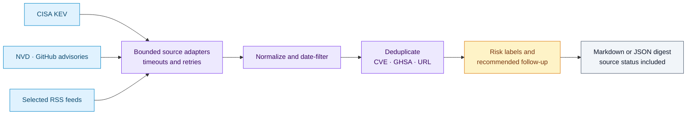

# Security Concept Web Scraper

A portable, local-first Python CLI that produces a daily Markdown or JSON
security digest suitable for a 50–60 person Microsoft 365 business. It combines
CISA KEV, NVD, GitHub Security Advisories, and selected security RSS feeds,
while keeping failures visible and isolated.

## Independent sources, one reviewable digest

Each source is fetched and normalized independently. A failed feed remains visible while available records continue through deduplication and risk labeling.



For a reproducible offline demonstration, run `security-digest --no-network --end-date 2026-09-19`. Use [source policy](docs/source-policy.md) to interpret coverage and [architecture](docs/architecture.md) to inspect the ranking rules.

## Quick start

Requires Python 3.10+ and no runtime dependencies.

```bash
python -m venv .venv
. .venv/bin/activate
pip install -e .
security-digest --days 1 --format markdown --output output/digest.md
security-digest --no-network --end-date 2026-09-19
```

Use `--format json` for automation. The default window is today only; `--days`
accepts 1–31. `--no-network` uses packaged deterministic sample responses.

## Daily automation

For example, a cron job on a managed workstation or server:

```cron
15 7 * * 1-5 cd /path/to/repo && /path/to/.venv/bin/security-digest --days 1 --output output/digest-$(date +\%F).md
```

Review output before actioning it. Schedule in the timezone appropriate to the
team; source timestamps are normalized as calendar dates.

## Configuration and sources

Edit `config/sources.json` to enable/disable sources or add an RSS entry with
an `id`, `type: rss`, and stable `url`. Timeouts, retries, and user agent live
there too. CISA KEV, NVD CVE API 2.0, GitHub Advisories, the OWASP Cheat Sheet
Series Atom feed, and Krebs RSS are enabled by default. The prior OWASP root
feed URLs (`https://owasp.org/feed` and `/feed.xml`) return 404; the configured
OWASP URL is the project's published `News.xml` feed. CSO and Dark Reading are
intentionally curated links only: no fragile or terms-sensitive HTML scraping is
performed.

Copy `.env.example` to `.env` only if useful. `NVD_API_KEY` and `GITHUB_TOKEN`
are optional. MSRC is disabled by default: set `MSRC_API_BASE` (and optionally
`MSRC_API_TOKEN`) only after choosing a documented Microsoft endpoint your
organization is permitted to use. This project does not invent an MSRC API.

Each included record always has title, source, date, risk level, affected
product/vendor, why it matters, recommended action, and URL. Deduplication uses
the source identifier (CVE/GHSA/URL); the stated CVSS/KEV thresholds are in the
digest header and [architecture notes](docs/architecture.md).

## Source limitations

This is an awareness and triage tool, not vulnerability management. NVD queries
use its millisecond ISO-8601 published-date parameters and remain within its
120-day API limit (the CLI allows at most 31 days). NVD and GitHub results are
bounded locally by published date; feeds may be delayed,
incomplete, or unavailable. RSS entries are Informational. Confirm ownership,
exposure, patch availability, and vendor guidance in your asset inventory. See
[source policy](docs/source-policy.md).

## Security and privacy

No credentials are hard-coded. `.env`, outputs, caches, logs, and local data are
ignored by Git. Keep tokens least-privilege, restrict file permissions, and do
not put customer or tenant data in configuration or issue reports. HTTP uses a
timeout, user agent, bounded retries/backoff, and standard TLS validation.

## Development

```bash
make test
make smoke
```

## GitHub publishing checklist

- Verify `.env` is absent and `.env.example` has placeholders only.
- Run `make test` and `make smoke`.
- Review `config/sources.json` and source terms for your use.
- Add repository description, topics, and a private vulnerability-reporting
  contact; then publish from your own GitHub account.
- Do not commit generated files under `output/`, `cache/`, `data/`, or `logs/`.
